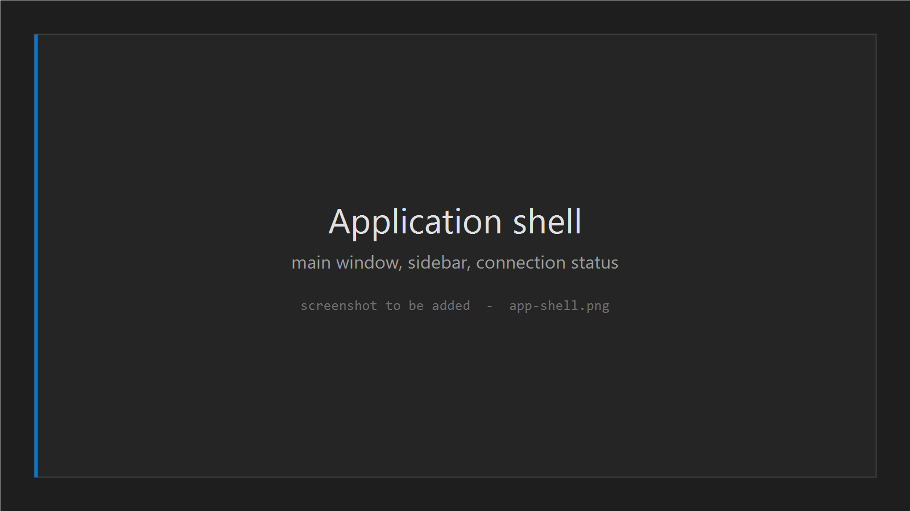
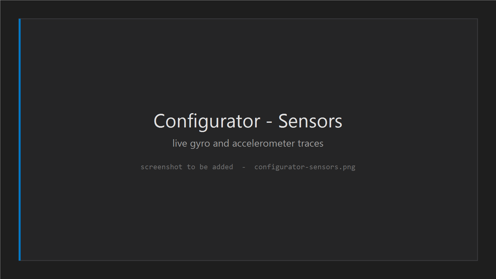
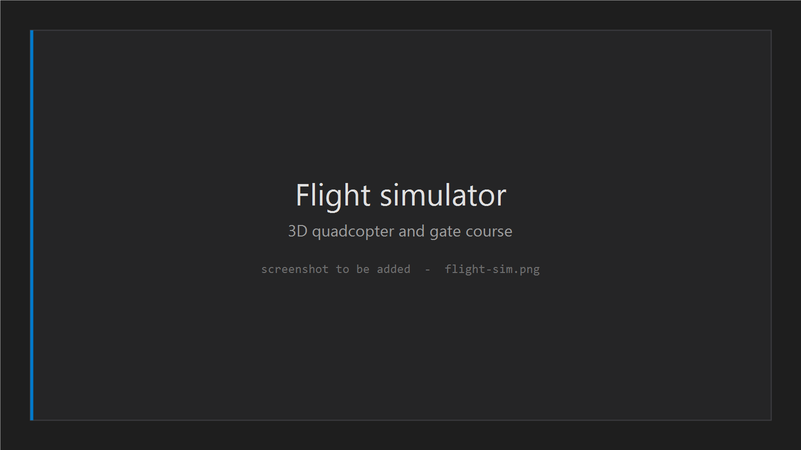

<p align="center">
  
</p>

<h1 align="center">Mimino Course-App</h1>

<p align="center">
  <strong>A desktop application that takes a student from “I have never touched a drone”<br>to flying a quadcopter they built themselves.</strong>
</p>

<p align="center">
  <em>Georgian-first · Windows &amp; Linux · by <a href="https://github.com/MiminoRobotics">Mimino Robotics</a></em>
</p>

---

> **About this repository.** This is a public overview of the Mimino Course-App. It explains what the
> product is and what it does. **The source code is private** and lives in a separate repository.
> Nothing here is code — it is documentation for people who want to understand the project.

---

## The problem

Building a quadcopter is only half of a drone course. A freshly assembled quad does nothing useful
until its **flight controller** — the small board that keeps it stable in the air — has been set up
correctly: sensors calibrated, radio bound, motors verified, flight behaviour tuned.

That setup is normally done in third-party tools that are dense, English-only, and unforgiving.
One wrong value and a student's first flight ends in a broken airframe — or a cut finger on the bench.

Mimino puts the whole path in one place, in the student's own language, and makes the dangerous parts
hard to get wrong.

## The path through the app

```
   LEARN            BUILD             CONFIGURE              PRACTISE            FLY
   ─────            ─────             ─────────              ────────            ───
  lectures   →   solder, wire,   →   calibrate, bind,   →   simulator with   →   first real
  & quizzes      assemble            test, tune             your own tune        flight
                                     (in the app)           (in the app)
```

The two middle-to-late stages are what this application is for. The student never leaves the window
between finishing the build and being ready to fly.

---

## Inside the app

The window has a single sidebar with four sections. One screen at a time — no floating panels,
no multi-window sprawl.

> 🖼 **Picture:** `docs/images/app-shell.png` — the main window and sidebar



### 1 · Course

Where the student learns. Video lectures and quizzes.

> Course content delivery is owned by the course team and sits outside this application's first
> release. The section exists in the shell and is filled in separately.

### 2 · Configurator — the heart of the product

The student plugs their quadcopter into the computer and works through the setup, one topic at a time.
Every page mirrors what a professional pilot would do, with the jargon removed and the order fixed.

| Page | What the student does |
|---|---|
| **Connect** | Plugs the quad in and confirms the app found the right board and firmware. |
| **Sensors** | Tilts the quad and watches its motion sensors respond live on screen. |
| **Calibration** | Teaches the quad what “level” means. |
| **Ports** | Assigns the board's connection points to the radio, GPS, telemetry, and so on. |
| **Receiver** | Confirms every stick and switch on the remote reaches the quad. |
| **Flight modes** | Decides which switch turns on which behaviour, such as self-levelling. |
| **Motor test** | Spins each motor alone to verify order and direction — behind hard safety gates. |
| **PID tuning** | Adjusts how sharply and smoothly the quad corrects itself. |
| **OSD** | Chooses what information is overlaid on the video feed in the goggles. |
| **CLI** | An expert-level text console for anything the pages above do not cover. |

The connection status — connected or not, on which port, running which firmware — is visible at all
times in the top bar. A student should never have to wonder whether the app is talking to their quad.

After any change, one **Save &amp; Reboot** button writes the settings permanently to the board,
restarts it, and reconnects on its own.

> 🖼 **Picture:** `docs/images/configurator-sensors.png` — live sensor view
>
> 🖼 **Picture:** `docs/images/configurator-ports.png` — port assignment
>
> 🖼 **Picture:** `docs/images/save-and-reboot.png` — the Save &amp; Reboot ritual



### 3 · Flight Simulator

Before risking a real airframe, the student practises on the computer.

- A 3D quadcopter responding in real time to the controls.
- A USB game controller stands in for the radio.
- Simulated physics — gravity, thrust, drag, momentum.
- A three-gate course to fly through, with lap times.

**The part that makes it a teaching tool:** the simulator is flown by the *same flight-controller
software* the real quad runs, loaded with *the settings the student just made in the Configurator*.
A sloppy tune feels wobbly in the simulator. A good tune feels smooth. The student discovers the
consequences of their own configuration before a propeller ever spins.

> 🖼 **Picture:** `docs/images/flight-sim.png` — the simulator with the 3D quad



### 4 · Settings

Interface language and appearance. Georgian is the primary language; English is available.

---

## Safety

Some of this software makes propellers spin. That is treated as the most serious thing the
application does, and the protections are part of the feature rather than polish added later.

| Gate | What it does |
|---|---|
| **Props-off checklist** | Nothing can spin until the student confirms, explicitly, that the propellers are off, the quad is on the bench, and they understand what is about to happen. |
| **Hard throttle cap** | Motor power is limited in the software itself, not just in the slider. A mistake cannot command full throttle. |
| **Heartbeat watchdog** | If the interface stops responding for a fraction of a second, every motor is cut automatically. |
| **Auto-stop** | Motors stop on leaving the page, losing the connection, the window losing focus, or any unexpected error. |
| **Always-visible STOP** | A large stop control is on screen the entire time motors can run. |

Every destructive action in the app — saving to the board, resetting it, spinning a motor — is
explicit, takes two steps, and has a visible way out.

---

## How it talks to the quadcopter

The app speaks the standard protocol that the quadcopter's flight-controller software already
understands, over a USB cable or a network connection. It reads the quad's current settings, shows
them in plain language, and writes changes back.

It does **not** replace the flight-controller software, and it ships none of that software's source
code. Students can cross-check anything the app does against the standard open tools.

For development and for the simulator, that same flight-controller software can run on the computer
itself as a virtual quadcopter — which is how a student can practise with no hardware attached.

---

## Design

The app is a tool students sit inside for hours, so it reads as a professional instrument rather than
a consumer app — closer to a code editor or a design tool than to a learning app.

- **Dark interface**, calm enough for long sessions.
- **Colour means something.** Green is connected, amber is caution, red is stop. Those never get
  spent on decoration.
- **Georgian typography treated properly.** Mkhedruli has no capital letters, and the interface
  never forces them.
- **The brand shows up where it belongs** — the airship mark in the top bar, and a warm
  “paper” reading surface for lecture content inside the dark shell.

> 🖼 **Picture:** `docs/images/design-tokens.png` — colour and type system

---

## Built with

| Layer | Choice |
|---|---|
| Platform | .NET 10 |
| Desktop interface | Avalonia (cross-platform, Windows + Linux) |
| 3D rendering | OpenGL via Silk.NET, glTF models |
| Flight-controller link | MSP V2 over USB-CDC and TCP |
| Simulation | Custom quadcopter dynamics bridged to the real flight-controller software |

Delivered as a numbered roadmap of sixteen releases, one reviewable slice at a time.

## Status

| Stage | State |
|---|---|
| Application shell — window, navigation, language, settings, logging | ✅ Complete |
| Configurator — connect, live sensors, save &amp; reboot | ✅ Complete |
| Configurator — calibration, ports, receiver, modes, motors, tuning, OSD, CLI | 🔨 In progress |
| Flight simulator — controller input, physics, 3D viewer, closed loop | 🔨 In progress |

## Deliberately not in scope

- Student accounts, logins, and progress tracking
- Course video hosting and the quiz engine
- A cloud backend or online sync
- Firmware installation on a brand-new board — students use the standard upstream tool once for that
- macOS

---

## Glossary

| Term | In plain words |
|---|---|
| **Quadcopter / quad** | A drone with four propellers. |
| **Flight controller** | The board that keeps the quad stable and turns stick movements into motor speeds. |
| **Firmware** | The software running on that board. |
| **Configurator** | The part of the app where the quad's settings are made. |
| **Calibration** | Teaching the quad's sensors what level and still look like. |
| **Receiver** | The radio part on the quad that listens to the remote control. |
| **Flight mode** | A behaviour, such as self-levelling, switched on from the remote. |
| **PID tuning** | Adjusting how strongly and quickly the quad corrects itself. |
| **OSD** | The information overlaid on the video from the quad's camera. |
| **Simulator (SITL)** | The quad's real flight software running on a computer instead of on a quad. |
| **Arming** | Enabling the motors. A quad that is not armed cannot spin up. |

---

<p align="center">
  <sub>© Mimino Robotics. All rights reserved. Source code is private; this repository is documentation only.</sub>
</p>
